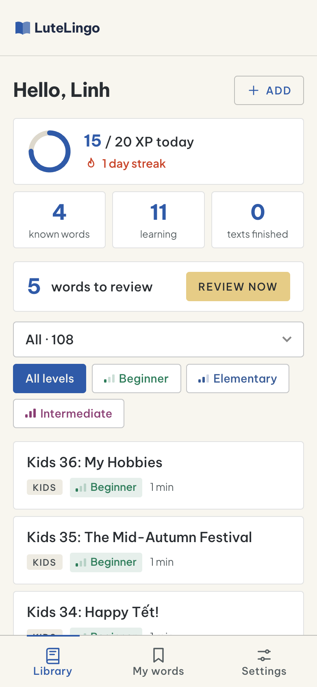
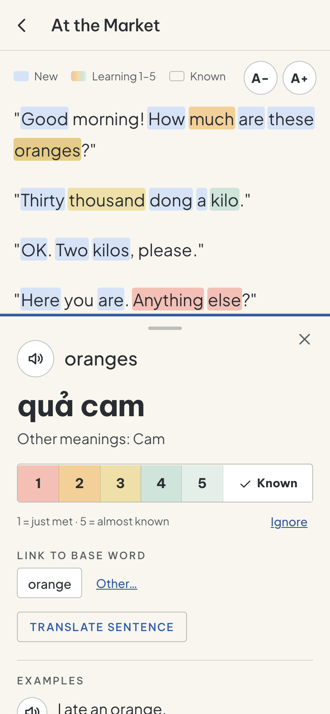
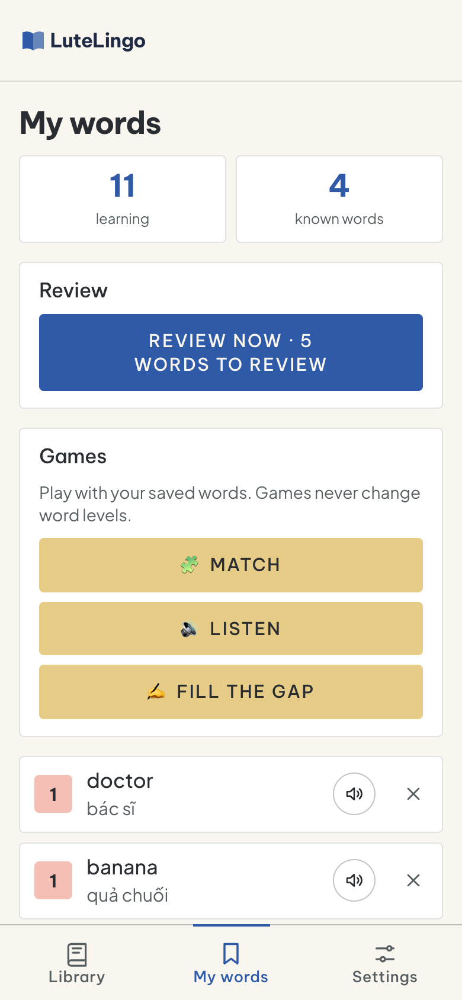
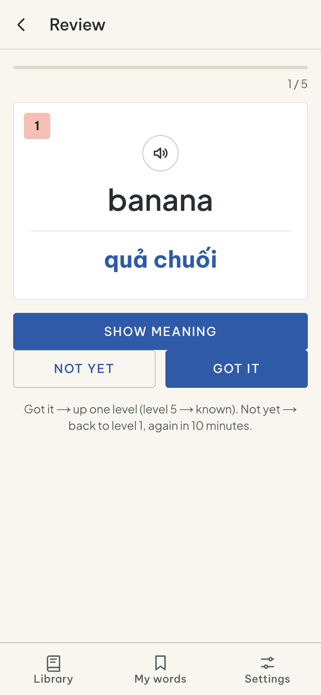
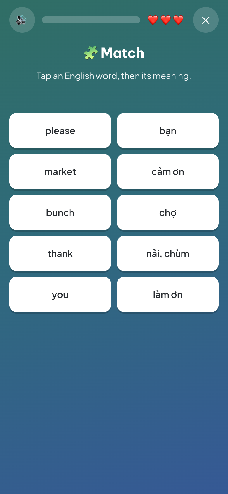

# LuteLingoApp

Phone-first reading app for learners of English. Students read English texts, tap any word for its meaning in their own language (Vietnamese or Indonesian today), hear it pronounced, see example sentences, and track every word's learning level, the way [Lute](https://github.com/LuteOrg/lute-v3) does. Teachers manage classes, texts and progress. Any school can host its own copy on Cloudflare's free plan, or [run it on one of its own computers](#run-it-on-your-own-computer-no-cloudflare) with no account at all.

- **Stack:** Astro 7 (server output) on Cloudflare Workers, D1 (SQLite), plain TypeScript. No UI framework.
- **Developer:** [souljasec](https://github.com/souljasec)
- **License:** [AGPL-3.0-or-later](LICENSE): free to use, change and self-host
- **Based on:** [Lute v3](https://github.com/LuteOrg/lute-v3) (MIT), see [THIRD_PARTY_NOTICES.md](THIRD_PARTY_NOTICES.md)

<p align="center">
  
  
  
  
  
</p>

> LuteLingoApp is an independent project based on Lute v3. It is not affiliated with or endorsed by the Lute project or its authors.

---

## For students

| Action | How |
|---|---|
| Translate a word | Tap it. A panel docks at the bottom with the meaning, other meanings, pronunciation and examples. The text stays live: tap or sweep the next word directly, no need to close first. A word hidden behind the panel is scrolled into view. Close with ✕ |
| Translate a phrase or sentence | **Sweep your finger sideways** across the words: they light up as you go, and lifting your finger translates and reads them aloud. To select across several lines, **hold** the first word for a moment, then drag in any direction. Moving up or down first just scrolls. On a computer, drag with the mouse |
| Phrase, two-step (Lute's way) | **Long-press** the first word, lift, then **tap** the last word |
| Translate the whole sentence | In the sheet, tap **Dịch cả câu** |
| Hear it again | 🔊 next to the word. Each example sentence has its own 🔊. The word being spoken is highlighted |
| Set a word's level | In the sheet: **1–5** (1 = just met, 5 = almost known), **✓ Đã biết** (known), **Bỏ qua** (ignore, e.g. names), **Xoá** (remove) |
| Finish a text | At the end: **Đánh dấu đã đọc xong** (+XP once per text). Words stay as they are: mark known words with **✓ Đã biết** one by one |
| Find a text | Library: newest texts first (also inside each category). Filter by category (a dropdown with counts: **Kids**, **World**, **Travel**, **Daily Life**, **Jobs**, **Science**, **Tech**, **Food**, **People**, **Legends**, **Art**, **Sport**, **Politics**, **Của tôi**), remembered on this device. A second row filters by **level** (both filters apply together). Each card shows its level as a coloured badge with 1–3 bars: **Cơ bản** (beginner, green), **Sơ cấp** (elementary, blue), **Trung cấp** (intermediate, plum). Students can set an optional level on their own texts |
| Add your own text | Library → **+ Thêm**. Paste any English text (a song, a story, an article). Optional level and category. **Ai được đọc**: *Chỉ mình tôi* (default) or *Cả lớp của tôi* (your classmates can read it too; it shows under its category in their library). Only you can edit or delete it. See *Adding a song* below |
| Review words | **Từ của tôi** (My words): learning words by level, with pronunciation and base word |
| Flashcards | Always in **Từ của tôi** (My words), plus a library card when cards are due. A word becomes a flashcard once it has a level 1–5. When nothing is due, My words shows when the next card is due. **Ôn tập** (from the library card "N từ cần ôn" or My words). Card shows the English word and reads it aloud, with **the sentence it was saved from** underneath (word highlighted) as a hint; **Hiện nghĩa** shows the meaning and base word. **Nhớ rồi** → up one level (level 5 → known); **Chưa nhớ** → back to level 1, again in 10 minutes. Next review: level 1 today, 2 in 1 day, 3 in 3 days, 4 in a week, 5 in two weeks (`src/lib/srs.ts`) |
| Base words (Lute "parent terms") | Tap *went*: the panel suggests **go** (irregular forms + -s/-es/-ies/-ed/-ing rules, `src/lib/lemma.ts`). One tap links them; the base word is created if needed and its meaning shown. **Từ khác…** to type one, **Bỏ liên kết** to unlink |
| XP, goal and streak | **XP:** +1 per word marked for the first time, +2 per correct flashcard (+1 for "not yet"), +10 for finishing a text (once per text). Changing levels back and forth earns nothing. **Daily goal** (Settings): 10 / 20 / 30 / 50 XP, shown as a ring in the library. **🔥 Streak:** days in a row with XP (Vietnam time); it stays alive until the end of today |
| Celebrations | "+N XP" toast; confetti + chime when the daily goal is reached, a text is finished, or a review session ends |
| Leaderboard | 🏆 in the library (students in a class): this week's XP per classmate, resets every Monday. Admins open it from a class page |
| Settings | Interface language (Tiếng Việt / English), **theme** (*Sáng* light / *Tối dịu* dim: a tinted dark, saved per account), reading text size, speech speed, daily goal, **voice** |
| Phrases | Select up to **5 words within one sentence** to save a phrase (*it's up to you*). Longer selections, or ones crossing a sentence end, still show the translation but can't be saved: sentences make poor flashcards |
| Computer | On a wide screen with a mouse, the text fills the left and the translation opens in a **panel on the right**; drag its left edge to resize it (300 px up to 60% of the window, the text keeps at least ~480 px; remembered on this device). **A− / A+** above the text change the text size (80–200%, remembered on this device, also on phones) |
| Coming back | Tap the **logo** for the library. Each text remembers how far you scrolled (on this device). Opening the app always starts at the library; its **Đọc tiếp** card goes back to the text read most recently, at the same place |
| Accounts | Students register **themselves with their real email** (a parent's email for young kids) and the class code. When a domain is verified in Resend later, *forgot password* emails go to those addresses; nothing needs re-registering |
| Install as an app | Android (Chrome): ⋮ → *Add to Home screen*. iPhone (Safari): Share → *Add to Home Screen*. Opens full-screen, no browser bar |

### Word colours (Lute's model)

| Colour | Meaning |
|---|---|
| Blue | New: never marked |
| Salmon → orange → mustard → teal → pale teal | Learning, levels 1 → 5 |
| No colour | Known ✓ or ignored |

Saved phrases are coloured as one block; tapping any word in a phrase opens the whole phrase.

### Example sentences

Examples come from **[Tatoeba](https://tatoeba.org)**, a free, volunteer-built collection of over 10 million sentences in hundreds of languages, many with **human** translations (licence CC BY 2.0 FR). The phone asks Tatoeba for English sentences containing the word that have a translation in the copy's language, skips sentences shorter than 4 words, and shows up to 3. They're written by volunteers, not teachers: usually good, occasionally odd. Rare words may have no examples, and the section is then hidden.

### Voices

Speech is produced **by the device itself** (the browser's built-in speech), not by our server. That is why a laptop and an iPhone sound different: each uses its own installed voices.

- Settings → **Giọng đọc / Voice** lists the English voices on *this* device (Apple's novelty voices are hidden). Picking one plays a sample; **Nghe thử** replays it.
- The choice is saved **on that device** (browser storage), so each phone or laptop keeps its own favourite. **Tự động** (Automatic) picks, in order: **Samantha** (iPhone, iPad, Mac) → *Microsoft Aria/Jenny* (Windows Edge) → **the phone's own default US voice** (Android) → any offline US voice.
- Voices marked **ngoại tuyến (offline)** support word-by-word highlighting. Some online Chrome voices ("Google US English") don't move the highlight.
- **iPhone tip:** Settings → Accessibility → Spoken Content → Voices → English → download *Samantha (Enhanced)* or a *Siri* voice. It then appears in the app's list.
- **Android tip (once per phone):**
  1. Settings → **Text-to-speech** (under *Accessibility* or *General management*).
  2. Engine: **Speech Services by Google** (Samsung phones default to Samsung's engine; switch it).
  3. ⚙️ → **Install voice data → English (United States)** → download, then listen and pick the nicest voice.
  4. The app's **Tự động** now uses that voice. Not tested on a real Android yet: note which voice it picks.

---

### Adding a song (or any text)

1. Get the words: search **song name + "lyrics"**, or open the song on YouTube → **…** → **Show transcript**, and copy.
2. Timestamps or odd characters in it? Paste into ChatGPT: *"Remove the timestamps, keep only the lyrics."* You can also ask ChatGPT for the lyrics directly, but check them against the original: it sometimes gets lines wrong.
3. In the app: **+ Thêm** → title → paste into **Nội dung (tiếng Anh)** → pick a level, category (e.g. *Music*) and who can read it → **Lưu bài đọc**.

Song lyrics are copyrighted: keep them to *Chỉ mình tôi* or your class, never post them publicly.

## For teachers (admin)

The **Quản lý / Manage** tab appears for admin accounts.

| Area | What you can do |
|---|---|
| **Class dashboard** | Open a class: **active this week** (x of y students), **XP this week**, **new words** and **texts finished** this week; a **daily XP heatmap** (one row per student, Monday last week → Sunday this week to match the weekly reset; darker square = more XP, bottom row = active students per day; tap a square for the numbers); **Cần chú ý** (needs attention): students inactive for 7+ days; every student with 🔥 streak, weekly XP, new words, known words, texts finished (sorted by weekly XP); the **most finished texts**; the 🏆 leaderboard. The class list shows active/total and weekly XP per class |
| **Join codes** | A class's code lets students join it themselves: at sign-up (*Mã lớp*) or later in **Cài đặt → Vào lớp bằng mã**. Joining puts them on your dashboard, gives them the class's texts, and adds them to its leaderboard. Make a new code any time (old code stops working) |
| **Classes** | Create a class and get a 6-letter **join code**. Students type it at sign-up (field *Mã lớp*) and join automatically. Make a new code, add or remove students by email, rename or delete the class |
| **Category spelling** | Typing a category in other capitals (*kids*) reuses the existing one (*Kids*), so class category limits keep matching |
| **Class categories** | On the class page, tick the categories the class may see (e.g. only *Kids* for a kids class). None ticked = everything. A student in several classes sees what any of them allows; texts posted to the class and students' own texts always show. It tidies the library; a direct link still opens other texts |
| **Students** | Per student: texts finished, known words, learning words, last active (updated once a day), texts read, recent words with level. Add to a class, **reset password** (shows a temporary password once and logs out old sessions), make or remove admin, delete the account with all its data |
| **Texts** | Each text has a **category** (pick an existing one or type a new one) and a **level**. School texts for **everyone** or only **selected classes**, with how many students finished each one. Admins can edit school texts (✎ in the reader) |

Admins never see students' private texts (only that they exist, in counts). Texts a student shares with their class are visible to admins too, and admins can edit or delete them (the pencil on the text). Who can read it stays as the student set it.

**Forgot password:** until a domain is verified in Resend, students ask a teacher, who uses **Reset password**.

---

## How it works

```
Phone (installed web app)
  │ HTTPS
  ▼
Cloudflare Worker (Astro server)
  ├─ pages: login, library, reader, my words, settings, admin
  ├─ /api/translate  D1 cache → Google (unofficial) → MyMemory
  ├─ /api/words      set a word's status / remove it
  ├─ /api/progress   finished / not finished
  └─ D1 database
From the phone directly: Tatoeba (examples), device speech (voice), translation fallback
```

### Text parsing (`src/lib/tokenize.ts`)

Ported from Lute v3's `SpaceDelimitedParser` (MIT) with Lute's English settings:

1. Character substitutions first: `´ ` ’ ‘` → `'`, `...` → `…`.
2. Each line is a paragraph.
3. Abbreviations (`Mr.`, `Mrs.`, `Dr.`, `U.S.`, `a.m.`, `p.m.`, `St.`, single initials like `J.` …) are matched before ordinary words, so they stay one word and don't end a sentence.
4. A gap containing `.`, `!` or `?` ends a sentence.

Differences from Lute, on purpose: `in.` and `No.` are not abbreviations ("Come in.", "No."); contractions (*didn't*, *it's*) stay one word; Vietnamese letters (`Ạ-ỹ`) count as letters so names like *Bác Hồ* are whole words; numbers are not words.

Saved multi-word terms are found in each sentence longest-first without overlap (`findPhrases`), like Lute's multiword matching.

### Translation

Google's dictionary endpoint and MyMemory both refuse Cloudflare's shared IP addresses (HTTP 429). So:

1. The server answers from the shared `translation_cache` when it can (words and phrases of up to 3 words).
2. Otherwise it tries Google, then MyMemory, and caches the result.
3. If both refuse, **the phone asks them directly** (its own IP). Phone results are *not* written to the shared cache, so nobody can put a wrong meaning in front of everyone.

A saved word shows the student's own translation first, as in Lute.

The target language is set once per copy in `src/brand/locale.ts` (`translateTo`), not per student, so saved words and the shared cache never mix languages.

### Data (D1)

`users` · `sessions` (SHA-256 of the cookie token, never the token) · `classes` · `class_members` · `texts` (visibility `all` / `classes` / `private`) · `text_classes` · `progress` · `saved_words` (term, translation, status 1–5 / 98 ignored / 99 known) · `translation_cache` · `password_resets`. Migrations are in `migrations/`.

**Visibility rule** (one SQL fragment in `src/lib/texts.ts`, used by every text query): a user may read a text if it is for everyone, linked to one of their classes, or their own. Admins read every school text but not students' private ones.

### Security

Full threat model, controls and the tests that check them: **[THREATS.md](THREATS.md)**.


- Passwords: PBKDF2-SHA256, 100,000 iterations (the Workers maximum), random salt per user.
- Sessions: 32-byte random token in an `HttpOnly; Secure; SameSite=Lax` cookie, 30-day sliding expiry.
- Forged cross-site form posts are blocked (Astro origin check).
- **Login lockout per account:** 10 wrong passwords lock that account for 15 minutes; an admin password reset unlocks it. It is per account, not per IP, because a whole class shares one school Wi-Fi address. (Cloudflare's IP rate limiter is approximate and per data centre, so it is only a best-effort extra on sign-up.)
- Expired sessions are deleted when the user next logs in.
- Text from users and outside services is always rendered as text, never as HTML.

### Design

Colours come from the brand pack (`src/brand/tokens.css`). Fonts: Be Vietnam Pro (headings; Outfit has no Vietnamese tone marks) and Plus Jakarta Sans (body). Uppercase button labels, 4px corners, no gradients or soft shadows. Line icons in `src/lib/icons.ts`.

---

## Develop

```sh
npm install
npm run db:migrate:local   # create/upgrade the local database
npm run dev                # http://localhost:4330, also on your Wi-Fi IP for phones
npm test                   # unit: passwords, tokens, parser, phrases, scheduling, dates
npm run test:e2e           # security suite against the running dev server (see THREATS.md)
npx tsc --noEmit -p .      # type check
```

Make yourself admin locally:

```sh
npx wrangler d1 execute DB --local --command "UPDATE users SET role='admin' WHERE email='you@example.com'"
```

Interface text lives in `src/lib/i18n.ts` (Vietnamese, Indonesian and English). Each copy shows only its own language and English in Settings (see `src/brand/locale.ts` below). To add a language, add it to `ALL` and `INTL`, add a dictionary with the same keys (TypeScript checks that none are missing), and add its codes for Google, MyMemory and Tatoeba in `src/pages/api/translate.ts` and `src/scripts/reader.ts`.

Starter texts are generated by the scripts in `scripts/` into `migrations/`.

### Releases

Versions follow [semver](https://semver.org): **patch** for fixes, **minor** for new features, **major** for changes that need action from people hosting a copy (for example a breaking config change). To release:

```sh
npm version minor          # bumps package.json, commits "1.1.0", tags v1.1.0
git push --follow-tags     # CI runs; when it passes, a GitHub release is published
```

The release notes list the commits since the previous version, so write commit subjects for readers. Self-hosters update by pulling the new tag (see *Updating safely* below).

## Run it on your own computer (no Cloudflare)

You don't need a Cloudflare account, a domain or a server: one computer at school (Windows, macOS or Linux) can host the app for a whole class. Students' phones and laptops on the same Wi-Fi open it in the browser. It runs the same code as the online version, in Cloudflare's open-source runtime (`workerd`) on your machine, and keeps everything in a local database file.

You need [Node.js](https://nodejs.org) 22 or newer, and internet access: meanings come from Google and MyMemory, example sentences from Tatoeba. Voices come from each device.

```sh
git clone https://github.com/souljasec/LuteLingoApp.git
cd LuteLingoApp
npm install
npm start          # creates/updates the local database, builds, serves on port 8787
```

Open **http://localhost:8787** on that computer. Other devices on the same Wi-Fi use the computer's address, for example `http://192.168.1.20:8787` (find it in the network settings, or with `ipconfig` on Windows, `ipconfig getifaddr en0` on macOS). Sign up, then make yourself admin:

```sh
npx wrangler d1 execute DB --local --command "UPDATE users SET role='admin' WHERE email='you@example.com'"
```

Good to know:

- Data lives in `.wrangler/state/` inside the project folder. Don't delete that folder: it holds every account, class and saved word. Back it up with `npm run db:backup:local` on macOS or Linux (writes a `.sql` file to `backups/`), or on any system stop the app and copy the whole `.wrangler/state/` folder. Backups hold students' personal data: keep them safe.
- To update: stop the app (Ctrl+C), `git pull`, `npm install`, `npm start`. Students keep everything; new migrations run automatically.
- Over plain `http://` on the Wi-Fi, phones can read, translate and listen, but can't *install* the app on the home screen (browsers allow that only on `https://` or `localhost`). Use the online version (below) if you need that.
- The app is only reachable while that computer is on and awake.
- For a projector lesson, the teacher can simply log in on the classroom laptop: click a word to see its meaning in the side panel, drag across words for a phrase or sentence.

## Deploy (host your own copy)

You need a free Cloudflare account.

```sh
npm install
npx wrangler login                       # or set CLOUDFLARE_API_TOKEN (Workers edit + D1 edit) in .env
npx wrangler d1 create lutelingo         # copy the database_id it prints into wrangler.jsonc
npm run db:migrate:remote                # create the tables and starter texts
npm run deploy                           # prints your app's URL
```

Sign up in the app, then make yourself admin:

```sh
npx wrangler d1 execute DB --remote --command "UPDATE users SET role='admin' WHERE email='you@example.com'"
```

Put your school's name, colours and logo in the brand pack (below). Never commit `.env` or the `backups/` folder.

### Updating safely (students keep everything)

Code and data are separate: `npm run deploy` replaces only the Worker code. The D1 database (accounts, sessions, classes, words, XP, streaks) is untouched, so students stay logged in and just get the new version on their next visit. Cloudflare switches versions instantly, and the service worker never caches pages.

Routine for every update:

```sh
npm run release   # with the dev server running (npm run dev)
```

`release` runs, and **stops at the first failure**: unit tests → security tests → backup of the live DB (→ `backups/`, git-ignored: personal data) → live migrations → deploy.

Migration rules: **only add** (new tables, new columns with defaults); never drop or rewrite student data; test locally first; apply migrations before deploying the code that needs them (old code ignores new columns). Recovery: restore a backup file, or D1 Time Travel (`npx wrangler d1 time-travel restore DB --timestamp=…`, last 7 days; 30 on the paid plan).

## Costs and limits (Cloudflare free plan)

- Static files (icons, styles, fonts) are free and unlimited.
- 100,000 requests/day and 100,000 database writes/day per account. Estimated about 200 requests and 30 writes per active student per day, so roughly **500 active students per day** before the $5/month plan is needed.
- CPU: pages and translations use 4–24 ms. Login and sign-up use 24–46 ms because of password hashing, above the free plan's 10 ms, but Cloudflare tolerates occasional overruns. If students see a Cloudflare "exceeded resources" error at login, move to **Workers Paid ($5/month)**. Don't weaken password hashing to avoid it.
- D1 Time Travel: the database can be rolled back to any point in the last 7 days (30 on the paid plan).

## Translation: move to an official API (to do)

Today's sources are **not official APIs**. `clients5.google.com/translate_a/t?client=dict-chrome-ex` is the internal endpoint of Google's Chrome dictionary extension, and MyMemory's anonymous tier has a small daily quota. Neither is meant for apps. Google can change or block the endpoint at any time without notice, and they already refuse Cloudflare's IPs, so in practice the **phones** call them from the school Wi-Fi, where 30 phones share one IP. If that IP gets rate-limited, untranslated words stop working for the whole class mid-lesson. Cached words keep working.

Plan: an official API first, today's chain as fallback.

| Option | Free per month | After that | Notes |
|---|---|---|---|
| **Microsoft Translator, tier F0** (recommended) | 2M characters | refuses requests; never bills on F0 | Azure account + card for verification. `/dictionary/lookup` returns alternative meanings, so it can replace MyMemory's "other meanings" too |
| Google Cloud Translation | 500k characters | ~$20 per 1M | Google Cloud account with billing |
| DeepL API Free | 500k characters | paid plan | Card for verification; check it's offered in Vietnam |
| Cloudflare Workers AI (`m2m100`) | inside the Workers AI daily allowance | very cheap | No sign-up, same account, but noticeably weaker translations |

Expected use: words and short phrases are cached once for everyone, so mostly sentences reach the API, roughly 30 students × 50 lookups × 30 characters ≈ 45k characters/day at most. Prices are as of 2026-10; check before signing up.

Steps (Microsoft):

1. Azure portal → create a **Translator** resource, pricing tier **F0**. Note the key and the region.
2. `npx wrangler secret put MS_TRANSLATOR_KEY` and `npx wrangler secret put MS_TRANSLATOR_REGION`; add both to `.dev.vars` for local dev.
3. In `src/pages/api/translate.ts`, add a source that tries first: `POST https://api.cognitive.microsofttranslator.com/translate?api-version=3.0&from=en&to=vi` (the language in `src/brand/locale.ts`) with headers `Ocp-Apim-Subscription-Key`, `Ocp-Apim-Subscription-Region` and body `[{"Text": q}]`. Keep Google and MyMemory as fallback.
4. Update `THREATS.md` (T2, T3) and the privacy policy (`src/pages/privacy.astro`): Microsoft becomes a recipient of looked-up words.

## If something breaks

| Symptom | Likely cause | What to do |
|---|---|---|
| Words show no translation / "unavailable" | Google or MyMemory refusing (HTTP 429) or the Google endpoint changed | `npx wrangler tail` and look for `translate source failed`. Long-term fix: the official API above. Short-term: pre-translate the starter texts into the cache |
| Cloudflare "exceeded resources" error, mostly at login | Free plan's 10 ms CPU limit (password hashing) | Switch to **Workers Paid ($5/month)**. Don't weaken password hashing |
| Site broken right after a deploy | Bad code | `npx wrangler rollback` returns to the previous version in seconds; then fix and `npm run release` |
| Data wrong or missing after a migration | Bad migration | Restore the latest file in `backups/`, or D1 Time Travel (`npx wrangler d1 time-travel restore DB --timestamp=…`) |
| Student forgot the password or is locked out | No reset emails yet; lockout is 15 min | Admin → Students → reset password (also unlocks right away) |
| Deploy token may have leaked | `.env` exposed | Cloudflare dashboard → My Profile → API Tokens → roll it, update `.env` |
| Everything down | Cloudflare outage | Check cloudflarestatus.com; nothing to do on our side |

Backups: `backups/` exists **only on the machine that ran the release** and holds students' personal data. Copy a recent dump somewhere else now and then, encrypted (e.g. `zip -e`), so a lost laptop doesn't mean lost backups.

Hand-over: whoever maintains this next needs access to the Cloudflare account, the GitHub repo, and this README. The app has no other moving parts.

## Content

Starter texts ship as migrations, are original, and are shared under the same open spirit as the code. Add your own from the admin screen.


| Category | Texts | Level | Source |
|---|---|---|---|
| Kids | 36 (family, pets, school, food, weather; numbers 1–100, days, months, time, seasons, colours, shapes, body, clothes, house, in/on/under, opposites, fruit, transport, Tết, Mid-Autumn, hobbies) | Beginner | Original (`scripts/kids_texts.py`, `scripts/more_texts.py`, `scripts/kids_more.py`) |
| World | 15 (North Vietnam 1–7, Bác Hồ, Different Cultures, Russia 1–4, Japan, Brazil) | Elementary–intermediate | Original (`scripts/seed_texts.py`, `scripts/more_texts.py`); the old *Vietnam* category was merged into *World* |
| Art, Sport, Politics | 6 / 7 / 4 | Beginner–intermediate | Original (`scripts/more_texts.py`). Politics is neutral and international (rules, government, UN, ASEAN) |
| Travel, Daily Life, Jobs, Science, Tech, Food, People, Legends | 5 each | 2 beginner, 2 elementary, 1 intermediate | Original (`scripts/interest_texts.py`). Legends: Aesop and Vietnamese folk legends retold |

All starter texts use only *to be*, present simple, past simple and future simple (*will*). Facts were written from memory: check dates before relying on them.

## Known gaps / next

- Forgot-password emails: needs a domain verified with an email provider (e.g. Resend).
- Official translation API (see "Translation: move to an official API").
- Not yet ported from Lute: pages for long texts, "where else did I see this word", Anki export.

## Credits

Parsing rules, term statuses, multiword matching and the mobile selection model follow [Lute v3](https://github.com/LuteOrg/lute-v3) (MIT). Example sentences from [Tatoeba](https://tatoeba.org) (CC BY 2.0 FR). Lute's MIT notice and other third-party licenses: [THIRD_PARTY_NOTICES.md](THIRD_PARTY_NOTICES.md).

## Brand pack

Everything that names or styles the app lives in two folders. The default brand is "LuteLingo" with a plain book logo. To make it your school's, replace the files in these folders; no other file names the school.

| File | What it is |
|---|---|
| `src/brand/brand.ts` | Name, voice-test greeting, browser bar colours, prefix for settings saved on the device |
| `src/brand/locale.ts` | The language English is translated into (`'vi'` or `'id'`, also the default interface language; Settings offers only it and English) and the school's UTC offset for days, streaks and the weekly reset |
| `src/brand/tokens.css` | Colour palette, light and dim themes |
| `src/brand/logo.svg` | Header lockup (inlined; uses `--logo-ink` / `--logo-accent`) |
| `src/brand/Decor.astro` | Artwork behind the login and sign-up screens (may render nothing) |
| `public/brand/` | `favicon.svg`, `favicon.ico`, `symbol.svg`, `logo.svg`, `icon-192.png`, `icon-512.png`, `icon-maskable-512.png`, `apple-touch-icon.png`, `manifest.webmanifest`, `offline.html` |

Keep `storagePrefix` once the app is in use: changing it resets students' saved zoom, filters, voice and reading positions. Database scripts use the binding name `DB`, so the D1 database can be called anything in `wrangler.jsonc`.

## Free knowledge for everyone

> ٱلَّذِى عَلَّمَ بِٱلْقَلَمِ ﴿٤﴾ عَلَّمَ ٱلْإِنسَـٰنَ مَا لَمْ يَعْلَمْ ﴿٥﴾
>
> “Who taught by the pen — Taught man that which he knew not.”
>
> — The Quran, Surah al-ʿAlaq 96:4–5 (Sahih International). From the very first revelation, and written on the dome of the Nation's Library in Ankara.

We believe in open source and free knowledge for everyone. Learning tools should not be locked away, so this app is free for anyone to use, study, change and share.

**You can:**
- Use it for free, for any purpose: a school, a class, a community group, or yourself
- Host your own copy on your own server
- Change it: translate it, add features, put your own name and logo on it
- Share it, changed or not, with anyone
- Charge for your own work around it, like hosting, setup or teaching

**You must:**
- Keep the copyright notice and this license
- Share your source code under the same license if you give a changed version to others, or run one for other people over the internet

**You can't:**
- Make it closed: hide your changes, or turn it into a secret paid product
- Remove the original developer's name or claim you wrote it
- Change the license to a different one
- Expect a warranty: it comes "as is"

The app's **About** page (`/about`, linked from the login screen and Settings) says the same to students and teachers in a short letter about free knowledge, in the interface language. It opens with this verse in Arabic and in a published translation (Sahih International in English, Kementerian Agama RI in Indonesian, Hasan Abdul-Karim in Vietnamese), names the developer, and links to this repository.

## License

Copyright (C) 2026 [souljasec](https://github.com/souljasec)

This program is free software: you can redistribute it and/or modify it under the terms of the GNU Affero General Public License as published by the Free Software Foundation, either version 3 of the License, or (at your option) any later version. See [LICENSE](LICENSE).

In plain words: any school or teacher can use it, change it and host it on their own servers for free. If you run a changed version for other people over the internet, you must share your changed source code under the same license, and keep this copyright notice.

